# Lora Gateway

**One self-hosted endpoint for every LLM.** Lora Gateway puts a single OpenAI-compatible *and* Anthropic-compatible
API in front of Together AI, Z.ai, OpenRouter, Anthropic, OpenAI, xAI and any other OpenAI-compatible service, and
adds a web console for providers, models, aliases, virtual API keys, budgets, request logs, cost analytics and an
interactive playground.

Routing is done by [LiteLLM](https://github.com/BerriAI/litellm); Lora Gateway adds the control plane (FastAPI),
the console (Vue 3) and an opinionated Docker Compose deployment with automatic HTTPS (Caddy).

**Recommended client: [malac](https://github.com/lobirus/malac)**, an autonomous coding agent for the terminal (Rust,
with a web UI and a VS Code extension). The two are built as one opinionated stack: malac does the work, and Lora
Gateway decides which model does it, keeps the keys and tracks what it costs. Any OpenAI- or Anthropic-compatible
client works too; see [Client configuration](#client-configuration).

| Light | Dark |
|---|---|
| 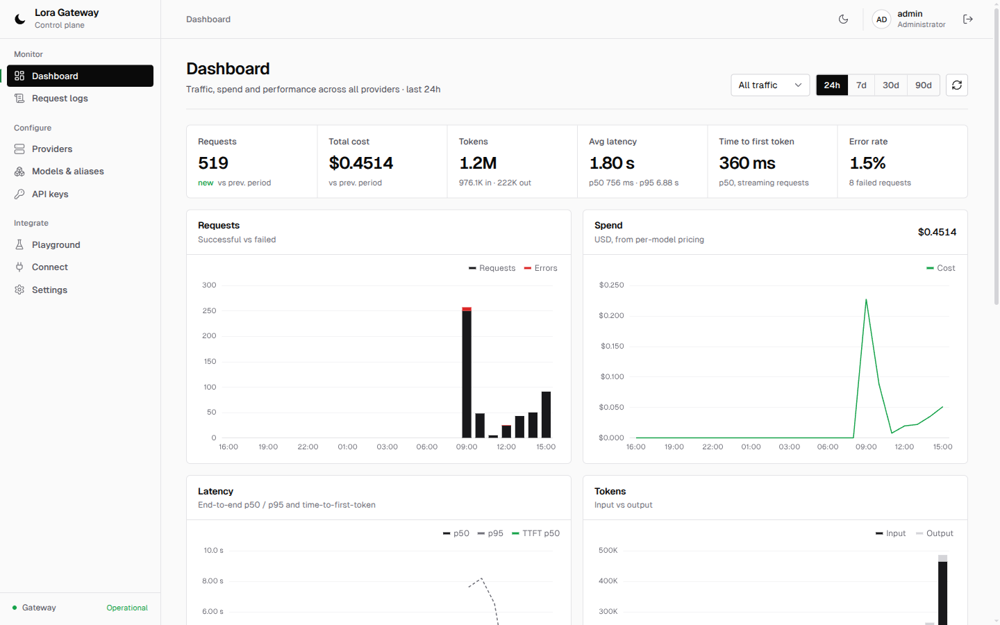 | 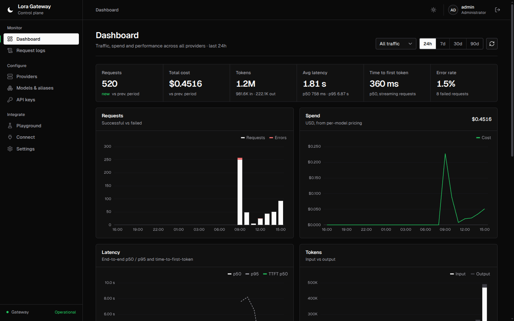 |
| 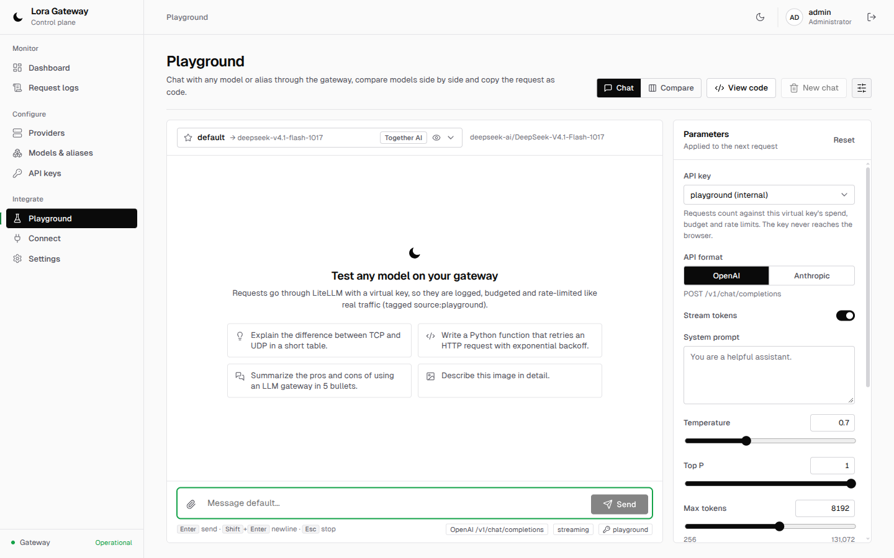 | 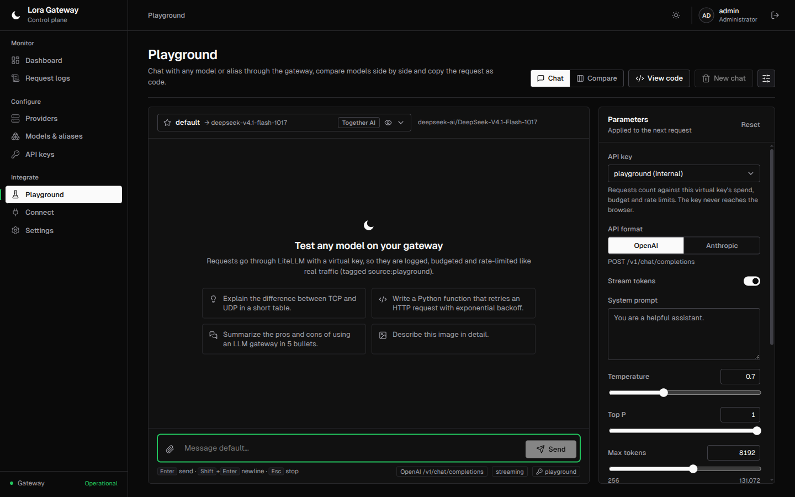 |
| 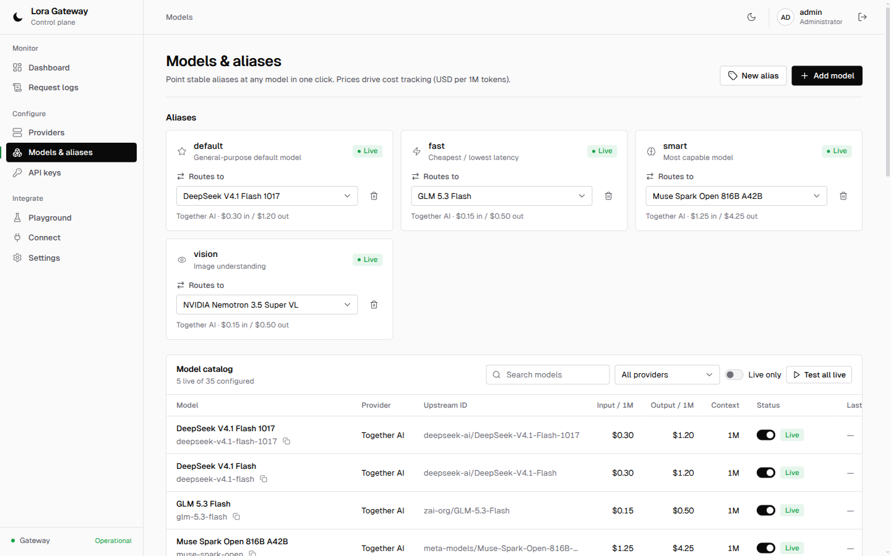 | 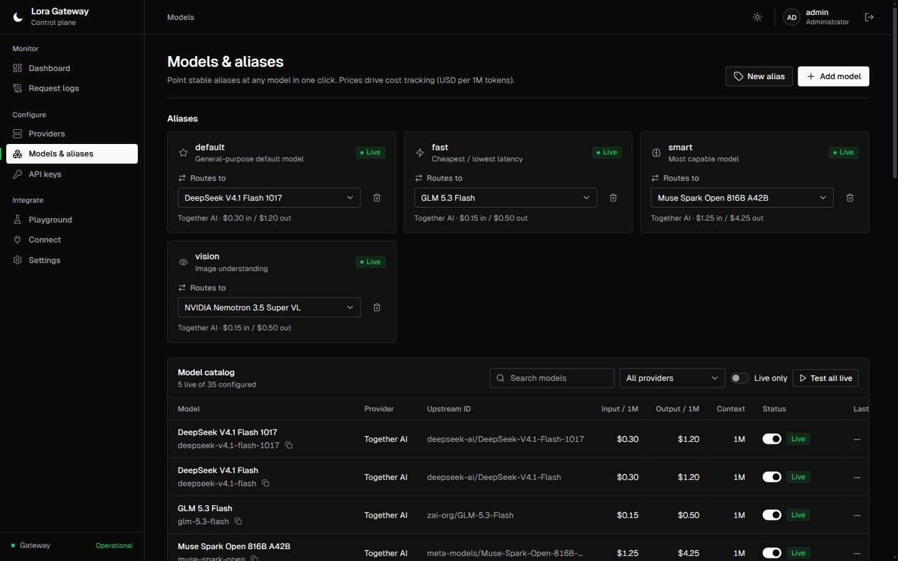 |
| 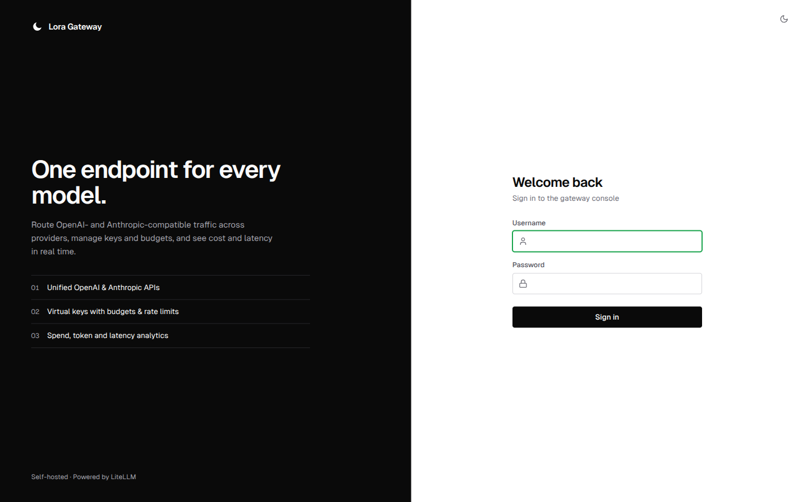 | 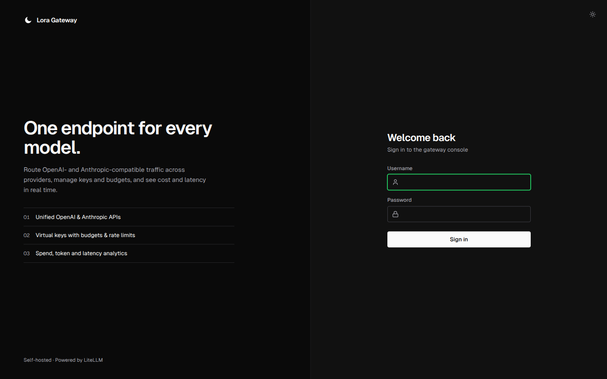 |

## Features

* **Two APIs, any model** — `/v1/chat/completions` (OpenAI) and `/v1/messages` (Anthropic) on the same host; LiteLLM
  translates between them, so Claude Code can talk to an open-weight model and an OpenAI SDK app can talk to Claude.
* **Providers** — Together AI, Z.ai (GLM), OpenRouter, Anthropic, OpenAI and xAI pre-configured (disabled until you add a
  key), plus any OpenAI-compatible base URL. Keys are encrypted at rest and can be tested from the UI.
* **Models & aliases** — browse a provider's upstream model list, set public names and per-1M-token prices, and point
  stable aliases (`default`, `fast`, `smart`, `vision`, or your own) at any model without touching clients.
* **Virtual API keys** — per-client keys with optional budget + reset period, RPM/TPM limits, model allow-list and expiry.
  Revoke instantly.
* **Analytics** — requests, tokens, cost, latency p50/p95, time to first token and error rate, by model, provider, key,
  source and day. Request logs with filters. Prompts are not stored.
* **Playground** — streaming chat with Markdown/code rendering, reasoning display, image input with vision guard,
  side-by-side compare of up to 3 models, OpenAI vs Anthropic format, per-response metrics, and *View code* to copy
  the request as curl / Python / JavaScript.
* **Connect page** — ready-to-paste configs for OpenCode, Hermes Agent, jcode, omp, Claude Code and the SDKs.
* **Secure by default** — no default credentials, secrets never reach the browser, only ports 80/443 published.

| | | |
|---|---|---|
| 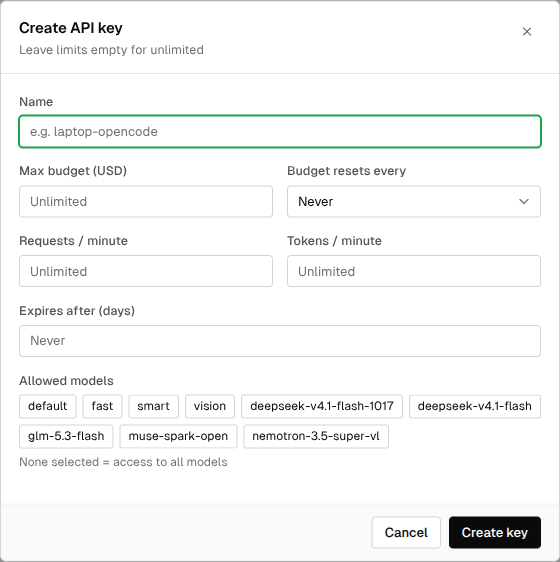 | 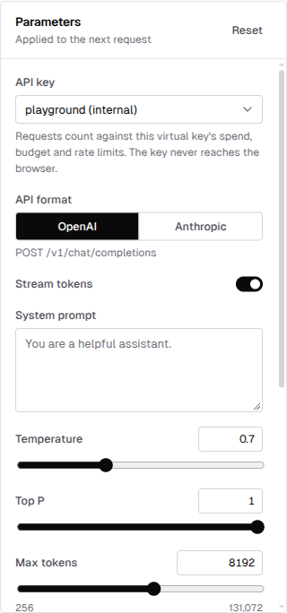 | 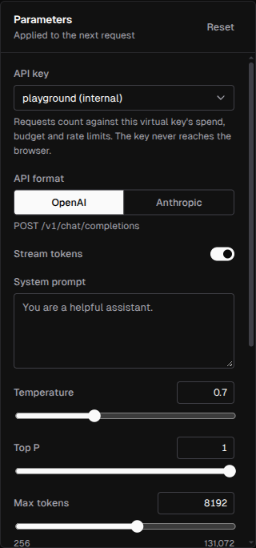 |


## Quick start

Requirements: a Linux host with Docker Engine + Compose v2, a DNS name pointing at it, and ports 80/443 reachable
(for Let's Encrypt). For a LAN/test install without public DNS, set `TLS_MODE=internal`.

```bash
git clone https://github.com/lobirus/lora-gateway.git
cd lora-gateway
cp .env.example .env
scripts/generate-secrets.sh          # fills every "change-me" with a random secret
$EDITOR .env                         # set PUBLIC_HOST=gateway.example.com (your DNS name)
docker compose up -d
docker compose logs backend | grep -A2 "Generated password"   # first start only
```

Open `https://<your-host>/`, log in as `admin` with the generated password (or the `ADMIN_PASSWORD` you set),
and change it under *Settings*. Then add a provider key (*Providers → Add key*) and create a virtual key
(*API keys → Create key*). A virtual key named `default` is created on first start.

## Configuration

All configuration lives in `.env` (see [`.env.example`](.env.example) for comments and generation commands).

| Variable | Required | Description |
|---|---|---|
| `PUBLIC_HOST` | **yes** | Public DNS name of the server, e.g. `gateway.example.com`. Used for the TLS certificate and in generated client configs. |
| `POSTGRES_USER` / `POSTGRES_PASSWORD` | yes | Credentials of the bundled Postgres (internal network only). |
| `LITELLM_MASTER_KEY` | yes | Admin key of the LiteLLM routing engine (`sk-…`). Used only by the backend, **never sent to the browser**. |
| `LITELLM_SALT_KEY` | yes | Encrypts provider keys in the LiteLLM DB. **Never change after the first start.** |
| `JWT_SECRET` | yes | Signs console sessions. |
| `ENCRYPTION_KEY` | yes | Fernet key encrypting provider and virtual keys in the gateway DB. **Never change after the first start.** |
| `ADMIN_USERNAME` | no | First admin account name (default `admin`). |
| `ADMIN_PASSWORD` | no | First admin password (≥ 10 chars). Empty = generated and printed once in the backend log. Only used while no user exists. |
| `SEED_TOGETHER_API_KEY` | no | Together AI key applied on the very first start only. |
| `TLS_MODE` | no | Empty = Let's Encrypt/ZeroSSL; `internal` = Caddy's internal CA. |
| `JWT_TTL_HOURS` | no | Console session lifetime (default 24). |

The backend refuses to start if a required secret is missing or still `change-me`.

## Adding providers and models

1. **Providers** → pick a pre-configured provider → *Add key* → paste the key, keep *Enabled* on, save.
   Its template models go live immediately; *Test* checks the key against the provider's `/models` endpoint.
2. **Models** → *Add model* → choose the provider → *Browse upstream* to pick a model → set the public name and the
   price per 1M input/output tokens (used for cost tracking) → save. Template model IDs and prices are starting
   points; verify them with your provider.
3. Any other OpenAI-compatible service: *Add provider* → type *OpenAI-compatible* → base URL + key.
4. **Aliases**: re-point `default` / `fast` / `smart` / `vision` (or create your own) from the dropdown.
5. **Capabilities** (*Models → Edit*): vision, reasoning, default/maximum output tokens and supported reasoning
   levels drive the Playground's defaults and guards.

## Client configuration

### malac (recommended)

[malac](https://github.com/lobirus/malac) is the client Lora Gateway is designed alongside. Install it, create a
virtual key in the console (**API keys → Create key**), then:

```bash
curl -fsSL https://raw.githubusercontent.com/lobirus/malac/main/install.sh | sh
export LORA_GATEWAY_API_KEY=sk-...        # or: printf %s "$KEY" | malac provider add lora --api-key-stdin
```

`~/.malac/config.toml`:

```toml
model = "lora/default"
small_model = "lora/fast"
vision_model = "lora/vision"

[providers.lora]
kind = "openai"
base_url = "https://gateway.example.com/v1"
api_key_env = "LORA_GATEWAY_API_KEY"
models = ["default", "fast", "smart", "vision"]

# The same gateway also speaks the Anthropic Messages API.
[providers.lora-anthropic]
kind = "anthropic"
base_url = "https://gateway.example.com"
api_key_env = "LORA_GATEWAY_API_KEY"
models = ["default", "fast", "smart", "vision"]

[profiles.fast]
model = "lora/fast"

[profiles.smart]
model = "lora/smart"
```

```bash
malac -y fix the failing test and verify it      # uses lora/default
malac --profile smart review this repo           # lora/smart
```

Because malac talks to aliases (`default`, `fast`, `smart`, `vision`), switching the underlying model or provider
is one click in the console (**Models & aliases**), with no client change. Every malac request shows up in the
dashboard and request logs with its cost and latency. The console's **Connect** page generates this config with your
own host and models filled in.

### Other clients


Create a virtual key in the console (the *Connect* page fills in the snippets for you) and export it:

```bash
export LORA_GATEWAY_API_KEY=<your virtual key>
```

Replace `gateway.example.com` with your `PUBLIC_HOST`.

**OpenCode** — `~/.config/opencode/opencode.json`
```json
{
  "$schema": "https://opencode.ai/config.json",
  "provider": {
    "gateway": {
      "npm": "@ai-sdk/openai-compatible",
      "name": "Lora Gateway",
      "options": { "baseURL": "https://gateway.example.com/v1", "apiKey": "{env:LORA_GATEWAY_API_KEY}" },
      "models": { "default": {}, "fast": {}, "smart": {}, "vision": {} }
    }
  },
  "model": "gateway/default",
  "small_model": "gateway/fast"
}
```

**Hermes Agent** — `~/.hermes/config.yaml`
```yaml
model:
  provider: "custom"
  base_url: "https://gateway.example.com/v1"
  api_key: "<your virtual key>"
  default: "default"
```

**jcode** (key read from stdin, stays out of shell history)
```bash
printf '%s' "$LORA_GATEWAY_API_KEY" | jcode provider add lora-gateway \
  --base-url https://gateway.example.com/v1 --model default --api-key-stdin --set-default
jcode --provider-profile lora-gateway auth-test
```

**omp (oh-my-pi)** — `~/.omp/agent/models.yml` (`apiKey` names the environment variable)
```yaml
providers:
  lora-gateway:
    baseUrl: https://gateway.example.com/v1
    apiKey: LORA_GATEWAY_API_KEY
    api: openai-completions
    models:
      - { id: default, name: "Gateway default", contextWindow: 262144, maxTokens: 32768 }
      - { id: fast, name: "Gateway fast", contextWindow: 262144, maxTokens: 32768 }
      - { id: smart, name: "Gateway smart", contextWindow: 262144, maxTokens: 32768 }
      - { id: vision, name: "Gateway vision", contextWindow: 262144, maxTokens: 32768, input: [text, image] }
```

**Claude Code / Anthropic SDK**
```bash
export ANTHROPIC_BASE_URL=https://gateway.example.com
export ANTHROPIC_AUTH_TOKEN="$LORA_GATEWAY_API_KEY"
export ANTHROPIC_MODEL=default
export ANTHROPIC_SMALL_FAST_MODEL=fast
claude
```

**curl**
```bash
curl https://gateway.example.com/v1/chat/completions \
  -H "Authorization: Bearer $LORA_GATEWAY_API_KEY" -H "Content-Type: application/json" \
  -d '{"model":"default","messages":[{"role":"user","content":"hi"}]}'

curl https://gateway.example.com/v1/messages \
  -H "x-api-key: $LORA_GATEWAY_API_KEY" -H "anthropic-version: 2023-06-01" -H "Content-Type: application/json" \
  -d '{"model":"default","max_tokens":256,"messages":[{"role":"user","content":"hi"}]}'
```

## Operations

```bash
docker compose ps                        # status / health
docker compose logs -f backend litellm   # logs
docker compose restart litellm           # restart one service
docker compose down                      # stop (data volumes are kept)
```

### Update

```bash
git pull
docker compose pull litellm postgres redis
docker compose build --pull backend caddy
docker compose up -d
LORA_GATEWAY_API_KEY=<key> python3 scripts/smoke_test.py --base https://gateway.example.com --models default
```

The backend re-syncs its model list into LiteLLM on every start (and on *Settings → Force sync*), so a LiteLLM
upgrade cannot lose models.

### Backup / restore

```bash
scripts/backup.sh     # backups/lora-gateway-YYYYmmdd-HHMMSS.sql.gz (both databases) + a copy of .env, keeps 14
# restore into a fresh install (same .env!):
gunzip -c backups/<file>.sql.gz | docker compose exec -T postgres psql -U "$POSTGRES_USER" -d postgres
```

Back up `.env` together with the dumps: it contains the keys that decrypt the stored provider keys. Store backups
somewhere private. Example cron entry: `15 3 * * * cd /path/to/lora-gateway && scripts/backup.sh >/dev/null 2>&1`.

### TLS

Caddy obtains and renews a certificate for `PUBLIC_HOST` automatically (ports 80/443 must be reachable).
Without public DNS, set `TLS_MODE=internal` and `docker compose up -d caddy`; clients then need to trust Caddy's
internal CA (or use `-k` for testing).

## Security notes

* **The LiteLLM master key is never sent to the browser.** The console talks only to the backend (`/api/*`) with a
  short-lived JWT; the backend uses the master key server-side to manage LiteLLM. The Playground also runs
  server-side, using a virtual key (the internal `playground` key or one you choose), so neither provider keys nor
  the master key reach the client.
* Provider keys and virtual keys are stored Fernet-encrypted; console passwords are bcrypt-hashed; failed logins are
  throttled.
* No default credentials: the first admin password is either yours (`ADMIN_PASSWORD`) or randomly generated and
  printed once. The backend refuses to start with placeholder secrets.
* Only Caddy is published (80/443, HSTS). LiteLLM (`127.0.0.1:4000`) and the backend (`127.0.0.1:8000`) listen on
  localhost only; Postgres and Redis only on the internal Docker network. LiteLLM's own admin UI is disabled.
* The console is same-origin (no CORS on `/api`); the session token is held in the browser's `localStorage`, so keep
  the console free of untrusted scripts and log out on shared machines.
* Anyone holding a virtual key can spend your provider credits: give each client its own key with a budget and
  rate limit.

See [SECURITY.md](SECURITY.md) for reporting vulnerabilities.

## Architecture

```
            :80/:443
 clients ──► Caddy (automatic HTTPS, serves the Vue SPA)
               ├── /v1/*   ──► LiteLLM proxy :4000 ──► Together / Z.ai / OpenRouter / Anthropic / OpenAI / xAI / …
               ├── /api/*  ──► FastAPI backend :8000 (control plane)
               └── /*      ──► static Vue 3 app
 Postgres 16: db "litellm" (LiteLLM keys, models, spend logs) + db "gateway" (users, providers, models, aliases, keys)
 Redis: LiteLLM router state (rate limits)
```

* **LiteLLM** (`ghcr.io/berriai/litellm:main-stable`) does routing, OpenAI ⇄ Anthropic translation, virtual-key auth,
  budgets/rate limits and writes every request to `LiteLLM_SpendLogs`. Models are stored in its DB
  (`store_model_in_db`); `litellm/config.yaml` holds no models.
* **Backend** (`backend/`, FastAPI + SQLAlchemy) is the source of truth for providers, models and aliases and reconciles
  them into LiteLLM through its management API. Analytics are SQL over `LiteLLM_SpendLogs`.
* **Aliases** are extra LiteLLM deployments named after the alias; switching an alias re-points it instantly.
* **Frontend** (`frontend/`, Vue 3 + Vite + TypeScript + ECharts) is built inside `caddy/Dockerfile` and served by Caddy.
  Monochrome design system in `frontend/src/styles.css` (light + dark), Geist fonts self-hosted, no external CDN.
* Control-plane API docs (OpenAPI) are served at `/api/docs`.

## Development

```bash
docker compose up -d postgres redis litellm backend   # backend on 127.0.0.1:8000, LiteLLM on 127.0.0.1:4000
cd frontend && npm ci && npm run dev                  # Vite dev server proxies /api -> :8000 and /v1 -> :4000
npm run build                                         # vue-tsc type-check + production build
```

See [CONTRIBUTING.md](CONTRIBUTING.md).

## License

[MIT](LICENSE) © 2026 lobirus
